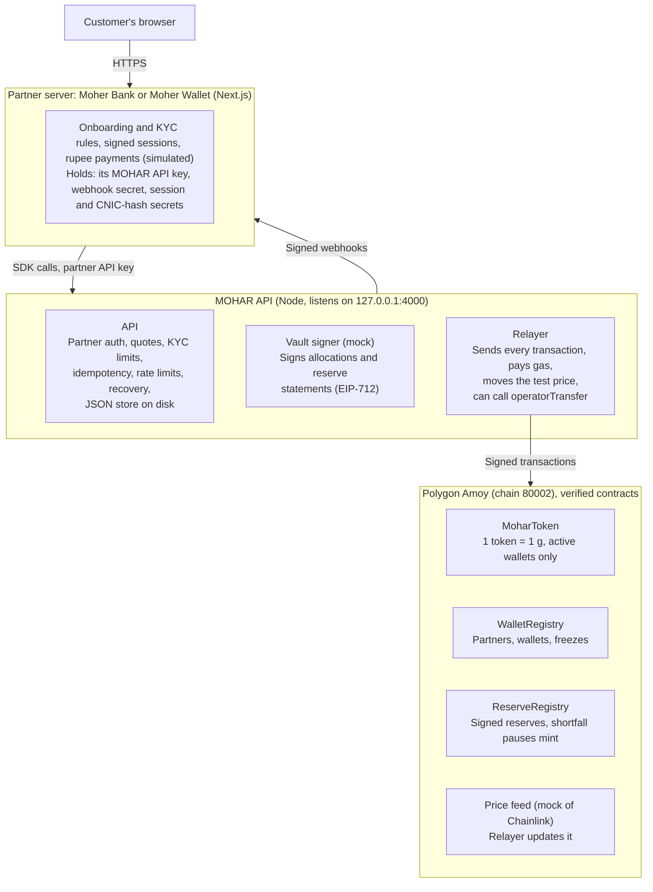

# MOHAR: security and engineering review brief

As of 18 November 2026 · prepared by Abdul Wasay (project manager)

## 1. Scope

Please review `main` at commit `27b111b` and tell us whether anything is missing, misplaced or unsafe
before the December FYP evaluation. The repository is public. A first pass takes about half a day; the
checklist in section 7 is the shortest route.

MOHAR is a final year project (FAST-NUCES, BS FinTech): a B2B service that lets a Pakistani bank or
mobile wallet offer Shariah-compliant gold savings from Rs 100. The partner keeps its customers, its KYC
and the rupees. MOHAR allocates gold in a vault, records ownership as tokens on Polygon (1 token = 1 g)
and publishes signed proof of reserve.

| In scope                                      | Out of scope                                       |
| --------------------------------------------- | -------------------------------------------------- |
| Solidity contracts in `contracts/`            | The vault itself (a mock signer stands in)         |
| The MOHAR API in `api/` and the SDK in `sdk/` | Real bank, Raast or NADRA integrations (simulated) |
| The demo partner app in `demo-bank/`          | Hosting: everything runs on one laptop today       |
| CI, dependencies, secrets handling            | Polygon mainnet: only the Amoy testnet is used     |

It is a testnet prototype. No real money or gold moves, but the design is meant to be sound enough to
take forward.

## 2. Architecture and trust boundaries

Three zones talk only through narrow channels: the partner calls MOHAR with its API key, MOHAR answers
with signed webhooks, and only MOHAR's relayer writes to the chain.



The partner never touches the chain, and the customer never holds a key. Customer wallets are custodial
addresses derived from `WALLET_MNEMONIC`. Every write on Polygon goes through the relayer, and every mint
or burn also needs the vault signer's signature, which is why section 6 starts with those two keys.

## 3. Repository map

| Path                                      | What it is                                                                   | Start with                                        |
| ----------------------------------------- | ---------------------------------------------------------------------------- | ------------------------------------------------- |
| `contracts/src/`                          | `MoharToken`, `WalletRegistry`, `ReserveRegistry`, shared types              | `MoharToken.sol` (mint, burn, `operatorTransfer`) |
| `contracts/script/Deploy.s.sol`           | Deploys all contracts and grants roles                                       | the role grants, lines 66–80                      |
| `contracts/test/`                         | 74 Foundry tests, including the H2 slippage experiment                       | `MoharToken.t.sol`                                |
| `contracts/deployments/`                  | Deployed addresses: `31337.json` (local), `80002.json` (Amoy)                | `80002.json`                                      |
| `api/src/http/`                           | Routes, partner auth, idempotency, rate limits                               | `routes.ts`, `auth.ts`                            |
| `api/src/services/`                       | Settlement (mint, burn, transfer, recovery), price, webhooks                 | `settlement.ts`                                   |
| `api/src/domain/`                         | Pricing, money, KYC fingerprint, KYC limits                                  | `kyc-limits.ts`, `pricing.ts`                     |
| `api/src/vault/mock-vault.ts`             | The mock vault: books and EIP-712 signatures                                 | whole file                                        |
| `api/src/config.ts`, `api/src/secrets.ts` | Settings and the refusal of public test secrets                              | `secrets.ts`                                      |
| `api/src/store/store.ts`                  | JSON-file store (or in memory)                                               | whole file                                        |
| `sdk/src/`                                | Typed client and webhook verification                                        | `client.ts`, `webhooks.ts`                        |
| `demo-bank/src/lib/`                      | Partner side: onboarding rules, sessions, customer and payment records       | `onboarding.ts`, `session.ts`, `secrets.ts`       |
| `demo-bank/src/app/`                      | Next.js 16 pages and server actions                                          | `actions.ts`                                      |
| `docs/`                                   | `openapi.yaml` (the API contract), `api.md`, `contracts.md`, `kyc-limits.md` | `openapi.yaml`                                    |
| `.github/`                                | CI workflow, Dependabot, CODEOWNERS, PR template                             | `workflows/ci.yml`                                |

Secrets are never in the repository. The real Amoy keys live only in git-ignored files on the project
manager's laptop: `api/.env.amoy`, `demo-bank/.env.amoy`, `demo-bank/.env.amoy.wallet` and
`contracts/.env`. Each folder has an `.env.example` that lists every setting.

## 4. Run and verify

On a fresh clone of `27b111b`, every check below passed on 18 November 2026. If any number differs on
your machine, that is the first thing to report.

You need Node 24, pnpm 10 and Foundry (`anvil`, `forge`, `cast`).

```bash
git clone https://github.com/Moher-FYP/moher && cd moher
git submodule update --init --recursive
pnpm install --frozen-lockfile
pnpm --filter @mohar/sdk build
```

| Check                                | Command                                                     | Expected                                      |
| ------------------------------------ | ----------------------------------------------------------- | --------------------------------------------- |
| Types                                | `pnpm typecheck`                                            | no errors                                     |
| Lint                                 | `pnpm lint`                                                 | no errors                                     |
| Formatting                           | `pnpm format:check` and `cd contracts && forge fmt --check` | clean                                         |
| Unit tests                           | `pnpm test`                                                 | SDK 11 passed, API 55 passed                  |
| End to end (Anvil, deploy, API, SDK) | `pnpm --filter @mohar/api test:e2e`                         | 23 passed                                     |
| Contracts                            | `cd contracts && forge test`                                | 74 passed                                     |
| Build                                | `pnpm build`                                                | demo app compiles                             |
| Dependencies                         | `pnpm audit --audit-level high`                             | exits 0 (one advisory ignored, see section 6) |
| API contract                         | `pnpm spec:lint`                                            | valid                                         |

To use it by hand, run four terminals from the repo root:

```bash
pnpm chain                                                  # local chain on :8545
pnpm contracts:deploy:local && pnpm --filter @mohar/api dev # API on 127.0.0.1:4000
pnpm --filter @mohar/demo-bank dev                          # Moher Bank, :3000
pnpm --filter @mohar/demo-bank dev:wallet                   # Moher Wallet, :3001
```

On http://localhost:3001, open an account, buy Rs 1,000, then try Rs 30,000: the second is refused by
the asaan KYC limit. The "Behind the scenes" panel shows every SDK call and webhook.

## 5. Security controls in place

Each control below is meant to be checked against the file named beside it. The fixes from the
14 November security review landed in PR #11, and the KYC and onboarding rules in PRs #19 and #20.

**On-chain** (`contracts/src/`)

| Control                                                                                                                          | Where                                                              |
| -------------------------------------------------------------------------------------------------------------------------------- | ------------------------------------------------------------------ |
| Every function that changes state is role-gated (OpenZeppelin `AccessControl`)                                                   | `MoharToken.sol`, `WalletRegistry.sol`, `ReserveRegistry.sol`      |
| Tokens move only between wallets registered and active, on both ends, mint and burn included                                     | `MoharToken._update`                                               |
| A mint or burn needs the vault's EIP-712 signature over the exact grams, a single-use reference and a deadline                   | `MoharToken._consumeVaultReceipt`                                  |
| A trade is refused if gold moved more than 0.50% from the quoted price (the gharar control), or the feed is stale                | `MoharToken._checkedPrice`, `MoharTypes.DEFAULT_MAX_DEVIATION_BPS` |
| Proof of reserve needs the vault's signature, an increasing nonce and an in-order snapshot; a shortfall pauses minting by itself | `ReserveRegistry.publish`                                          |
| Only the relayer may move the test price feed                                                                                    | `mocks/MockV3Aggregator.sol`, `Deploy.s.sol`                       |
| The demo wallet partner is registered only on Anvil and Amoy                                                                     | `Deploy.s.sol`                                                     |

**API** (`api/src/`)

| Control                                                                                                 | Where                                                   |
| ------------------------------------------------------------------------------------------------------- | ------------------------------------------------------- |
| Partner API keys (Bearer); each partner sees only its own wallets, quotes and transactions              | `http/auth.ts`, `http/routes.ts`                        |
| An operator key, separate from partner keys, for the test price routes, which move the price at most 5% | `http/auth.ts` (`timingSafeEqual`), `services/price.ts` |
| The API refuses to start with the repository's public test keys on any chain but local Anvil            | `secrets.ts`                                            |
| Listens on 127.0.0.1 by default; 100 KB request body limit                                              | `config.ts`, `app.ts`                                   |
| Idempotency keys on every write; one quote settles once, even for two requests at the same moment       | `http/idempotency.ts`, `claimQuote` in `http/routes.ts` |
| Rate limits per partner: requests a minute and new wallets an hour                                      | `http/rate-limit.ts`                                    |
| KYC limits per level (per trade, 24 h, 30 days, most held), applied to purchases and to gold received   | `domain/kyc-limits.ts`, `http/routes.ts`                |
| The partner's KYC reference is stored only as an HMAC under `KYC_HASH_SECRET`                           | `domain/kyc.ts`                                         |
| Webhooks signed per partner, HMAC-SHA256 over timestamp and body, 5-minute tolerance                    | `services/webhooks.ts`, `sdk/src/webhooks.ts`           |
| Unfinished trades are reconciled with the chain on restart                                              | `services/settlement.ts` (`recover`)                    |

**Demo partner** (`demo-bank/src/`)

| Control                                                                                                                                 | Where                                   |
| --------------------------------------------------------------------------------------------------------------------------------------- | --------------------------------------- |
| The API key stays on the server (`server-only`); nothing secret uses the `NEXT_PUBLIC_` prefix                                          | `lib/mohar.ts`                          |
| Session cookie signed (HMAC), `httpOnly`, `sameSite=lax`, `secure` in production                                                        | `lib/session.ts`, `app/actions.ts`      |
| `SESSION_SECRET` and `CUSTOMER_HASH_SECRET` required in production                                                                      | `lib/secrets.ts`                        |
| One account per CNIC, a phone not used by another customer, no expired CNIC, age 18+; only masked numbers and keyed fingerprints stored | `lib/onboarding.ts`, `lib/customers.ts` |
| Records written atomically, mode 0600                                                                                                   | `lib/datafile.ts`                       |

**Process**

CI runs Foundry format, build and tests, a check that the API's ABIs match the contracts, `pnpm audit`,
spec lint, a check that the SDK types match the spec, then typecheck, lint, tests and end-to-end
(`.github/workflows/ci.yml`). Dependabot is on.

## 6. Threat model and known gaps

The biggest risk is concentrated keys: one relayer key and one admin key, both on one laptop, with no
multisig or timelock. We know about everything listed here; please tell us what is missing and whether
the ranking is right.

**Where the trust sits**

| Key                               | Holds                                                                                                  | If it leaks                                                                                                                                                                    |
| --------------------------------- | ------------------------------------------------------------------------------------------------------ | ------------------------------------------------------------------------------------------------------------------------------------------------------------------------------ |
| Relayer (`0xe6cf…619f`)           | `SETTLEMENT_ROLE`, `OPERATOR_ROLE`, `REGISTRAR_ROLE`, `PUBLISHER_ROLE`; sole updater of the test price | Can move any customer's tokens with `operatorTransfer` (no vault signature needed), register wallets and set the test price. Cannot mint or burn without the vault's signature |
| Deployer / admin (`0x08Db…C13C`)  | `DEFAULT_ADMIN_ROLE` on all three contracts, `PAUSER_ROLE`, `PARTNER_ADMIN_ROLE`, `COMPLIANCE_ROLE`    | Can grant any role, swap the vault signer or price feed, change the 0.5% limit, register partners, freeze wallets                                                              |
| Vault signer (`0x832a…4025`)      | Signs allocations and reserve statements                                                               | Together with the relayer key, can mint unbacked tokens and publish a false reserve                                                                                            |
| `WALLET_MNEMONIC`                 | Derives every customer's custodial address                                                             | Addresses only today: tokens are moved by the relayer, not by customer keys                                                                                                    |
| Partner API keys, webhook secrets | One pair per partner                                                                                   | Act as that partner; forge its webhooks                                                                                                                                        |

The vault signer, relayer and mnemonic all sit in `api/.env.amoy`, so today MOHAR attests to its own
reserves. In a real deployment the vault would sign independently.

**Open findings from the 14 November review**

| #   | Finding                                                                                                                        | Status                               |
| --- | ------------------------------------------------------------------------------------------------------------------------------ | ------------------------------------ |
| 15  | `main` has no branch protection; four PRs were merged without review; CODEOWNERS still has placeholders for the technical lead | Open                                 |
| 17  | Demo login has no password: anyone can pick a customer. Cookies cannot be forged                                               | Half closed (by design for the demo) |
| 8   | KYC level was stored but never enforced                                                                                        | Closed in PR #19                     |

**Accepted limits of the prototype**

- Findings 5, 6, 7 and 16: a mock vault, a mock price feed on testnet, a single relayer, quotes held in
  memory.
- The API store is one JSON file in one process: no database, no horizontal scaling.
- NADRA, mobile-operator SIM checks, liveness and Raast are simulated.
- `pnpm audit` ignores GHSA-fc5q-39xc-vjpf (picomatch ReDoS): no fixed version yet, and it only runs in
  linting. CI audits production dependencies only (`--prod`).
- No third-party audit, no static analysis (Slither, Aderyn) and no invariant tests yet. Fuzz tests exist
  only for the H2 slippage experiment.

## 7. Reviewer checklist

Tick each item in a copy of this file or in your notes, and raise an issue for any you would change.

**Setup**

- [ ] A fresh clone builds and every check in section 4 matches the expected numbers
- [ ] No secret, private key or real `.env` file is in the repository or its history

**Contracts**

- [ ] Role grants in `Deploy.s.sol` give each account only what it needs
- [ ] `mint` and `burn` cannot run without a valid vault signature, an unused reference and a future deadline
- [ ] `operatorTransfer` is acceptable as it stands, or should be limited (for example, to a signature from the customer's partner)
- [ ] `_checkedPrice` enforces the 0.5% limit and refuses a stale feed
- [ ] `ReserveRegistry.publish` cannot be replayed or reordered, and a shortfall pauses minting
- [ ] Admin powers (`setVaultSigner`, `setPriceFeed`, `setMaxDeviationBps`) need a multisig or timelock before mainnet
- [ ] Rounding in grams (8 decimals) and paisa cannot be exploited by many small trades

**API and SDK**

- [ ] A partner can never read or act on another partner's wallets, quotes or transactions
- [ ] Idempotency and `claimQuote` prevent double settlement under concurrent requests
- [ ] KYC limits cannot be bypassed: split purchases, transfers in, two requests at once
- [ ] Webhook signing and verification are correct, including the replay window
- [ ] Restart recovery cannot settle a trade twice or lose one
- [ ] Error responses leak nothing internal (stack traces, keys, file paths)

**Demo partner**

- [ ] Server actions check their input, and nothing secret reaches the browser
- [ ] No CNIC or phone number is stored in the clear in `.data/`
- [ ] Production refuses to run without `SESSION_SECRET` and `CUSTOMER_HASH_SECRET`

**Process**

- [ ] CI covers what matters, and the audit configuration is sound
- [ ] Branch protection and CODEOWNERS should be set as proposed in section 9

## 8. Live on Polygon Amoy

All four contracts were deployed on 14 November 2026 (chain 80002) and verified as exact matches on
Polygonscan and Sourcify (solc 0.8.24, 200 runs, cancun). Deployment used 5,390,973 gas (0.162 POL).

| Contract or account    | Address                                                                                                                              |
| ---------------------- | ------------------------------------------------------------------------------------------------------------------------------------ |
| MoharToken             | [`0x0e400045515297fd9Ffd2B48fc2f491C353df4Ab`](https://amoy.polygonscan.com/address/0x0e400045515297fd9Ffd2B48fc2f491C353df4Ab#code) |
| WalletRegistry         | [`0xA55d6387Add80091A1A928fB5F111Ff1fC3d9B0E`](https://amoy.polygonscan.com/address/0xA55d6387Add80091A1A928fB5F111Ff1fC3d9B0E#code) |
| ReserveRegistry        | [`0x19722fb8F7B497509B48501879122C6D37dFFE4D`](https://amoy.polygonscan.com/address/0x19722fb8F7B497509B48501879122C6D37dFFE4D#code) |
| Gold price feed (mock) | [`0x231B8C62c734e76fd0935226cC7aAC9029cf3E19`](https://amoy.polygonscan.com/address/0x231B8C62c734e76fd0935226cC7aAC9029cf3E19#code) |
| Deployer / admin       | [`0x08Db639191A50618F87ED065cd24F68198C4C13C`](https://amoy.polygonscan.com/address/0x08Db639191A50618F87ED065cd24F68198C4C13C)      |
| Relayer                | [`0xe6cfdB90e60D00Ee5d8c85E44F026083f192619f`](https://amoy.polygonscan.com/address/0xe6cfdB90e60D00Ee5d8c85E44F026083f192619f)      |
| Vault signer           | `0x832a2c7cCB1EB18850DA618E0D474a096e9A4025`                                                                                         |

Transactions worth checking:

- [A purchase: Rs 25,000 for 0.7156 g](https://amoy.polygonscan.com/tx/0x63616ed971813b4e7c1b6e4c1916ca21e9a6e416695b940cbb23a77eb0de1071) (14 Nov)
- [A sale: 0.887 g burned](https://amoy.polygonscan.com/tx/0xf0758bea307c8b18b0f41c682d374b5ddef1866c42170f69c543589fb9d40efb) (16 Nov)
- [Moher Wallet registered as a second partner](https://amoy.polygonscan.com/tx/0xe3e1735078d8ab3bdeab5c805e9827f6051f5a97a7e2d8f27dccc0017b9ea55f) (18 Nov)
- [A Moher Wallet purchase, Rs 1,000 for 0.0289 g](https://amoy.polygonscan.com/tx/0x8f0063f6af7bdf182fa44107974f003dffc7e625ecc28cf9e17b13a419e0ae45) and [a 0.005 g transfer](https://amoy.polygonscan.com/tx/0x743c134f46e6da377a1223c7840e305ac343e704fe4719b35dfef63bbea1dead) (18 Nov)

The slippage refusal leaves no transaction: the API simulates each trade before sending it, and the
contract's own 0.5% check refused it there. On 18 November the vault held exactly what customers owned
(0.0293 g, attestation #5), and the relayer had 0.36 POL, enough for about 30 more trades.

## 9. Questions for you, and how to report

The questions we most want answered:

1. Is the role layout safe enough for a testnet FYP, and what is the minimum change before mainnet
   (multisig, timelock, splitting the relayer's roles)?
2. Should `operatorTransfer` need a signature from the customer's partner, so a leaked relayer key cannot
   move customers' gold?
3. What is the cleanest way to make the vault sign independently of the API, so reserves are not
   self-attested?
4. Do you see a way around the KYC limits or the one-quote-one-trade rule?
5. Which static analysis tools and invariant tests would you add first?
6. Proposed branch protection on `main`: 1 approving review, CI green, no direct pushes, CODEOWNERS
   filled in. Anything more?

Please report each finding as a GitHub issue on this repository, with:

| Field            | What to write                             |
| ---------------- | ----------------------------------------- |
| Severity         | Critical, high, medium, low, or note      |
| Where            | File and line, or contract and function   |
| What happens     | The attack or bug in one or two sentences |
| How to reproduce | Steps or a failing test                   |
| Fix you suggest  | Optional                                  |

Contact: Abdul Wasay (project manager), goesbyabdulwasay@gmail.com.
